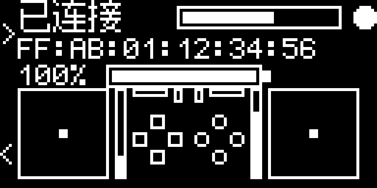

  

# DS4/5-monitor

基于 Pico 2 W 的 DS4 / DS5 蓝牙转 USB 桥接固件，配合中文 OLED 查看状态、调整手柄设置。电脑通过 USB 连接小板，手柄通过蓝牙连接小板。

**0.01 预发布版** · Windows PC · 中文 prop16 · 四个配对槽，一次连接一只手柄

[下载固件](https://github.com/magicx09/DS4-5-monitor/releases) · [硬件与接线](docs/HARDWARE.md) · [使用指南](docs/USAGE.md) · [技术讨论](docs/TECHNICAL.md) · [本机编译](docs/BUILD.md) · [参考项目](docs/REFERENCES.md)

*主界面点阵预览，信号和地址使用示例数据。*

## 这个分支改了什么

项目从 DS5Dongle 的 OLED 分支继续开发，加入 DS4 支持，并把配对、扬声器、音量控制和每只手柄的设置接到同一套界面里。DS4 可以关闭振动，换到 DS5 时恢复它自己的设置，不用来回调。

音频是开发中花时间最多的部分。DS4 曾经已经收到音频、完成编码和蓝牙发送，扬声器却不响，最后查到音量更新允许位被过滤。DS5 则遇到游戏已经向手柄输出独立音效，但功放音量状态没有同步的问题。相关报告字段、排查过程和修改放在[技术文档](docs/TECHNICAL.md)里。

| 功能 | 0.01 状态 |
| --- | --- |
| DS4 按键、摇杆、触摸板、体感、普通震动、灯条 | 开发期间已实机确认 |
| DS4 内置扬声器 | 已接通 SBC 音频和音量控制，开发期间确认有声 |
| DS5 输入、原生触觉、自适应扳机、扬声器 | 保留上游支持，修正音频控制状态 |
| 电脑音箱与 DS5 分别播放 | 支持游戏原生的双路输出，开发期间确认音量恢复后有声 |
| 每只手柄独立设置 | 按四个配对槽保存，同型号手柄也能分别设置 |
| OLED | 中文菜单、电量、实时信号条、配对、设置和诊断页面 |

0.01 已通过 425 项主机测试和固件镜像检查，最终整包的硬件回归尚未完成，因此先以预发布版提供。具体测试和待验证项目见[验证记录](docs/VALIDATION.md)。麦克风不在当前开发范围；本版关闭桌面配置器使用的厂商管理接口，设置通过 OLED 完成。

## 硬件

- **树莓派 Pico 2 W 开发板**。
- **微雪 Pico-OLED-1.3：树莓派 Pico 1.3 寸 OLED 显示屏模块扩展板，SH1107 芯片，带 KEY0 / KEY1。**
- 支持数据传输的 Micro-USB 线，以及匹配的排针／排母。

这块微雪扩展板支持 SPI / I²C，商品名称可能写着“I2C 接口”。**当前固件使用 SPI1**，屏幕横向显示为 128×64。购买和接线请按[硬件文档](docs/HARDWARE.md)核对，纯四针 I²C 屏不能直接使用此固件。

## 上手

1. 从 [Releases](https://github.com/magicx09/DS4-5-monitor/releases) 下载 `DS4-5-monitor-0.01-pico2w-zh-prop16.uf2`。
2. 按住 Pico 2 W 的 **BOOTSEL** 接入电脑，将 UF2 复制进启动盘，等待开发板重启。
3. 在 OLED 选择空配对槽，长按 **KEY0 两秒**开启配对。DS4 按住 **SHARE + PS**，DS5 按住 **创建键 + PS**，直到灯条快闪。
4. 连接后进入设置，用方向键调整，**△ 保存**。例如在 DS4 的槽中关闭左右握把振动，在 DS5 的槽中保留 1.0x。

主界面信号条越满，接收信号越强；刚连上还没有读数时显示空框。**KEY0 + KEY1 按住两秒翻转屏幕，继续按到五秒重启。**

## 音箱放主声音，手柄放独立音效

支持 DualSense 原生音频的游戏，可以把音乐、环境声送给电脑音箱，把武器或脚步等专用音效送给手柄。使用时保持电脑音箱为默认输出，保留 DualSense 播放端点，并在 OLED 音频设置里开启、保存**锁定音量**。Windows 对手柄端点的音量和静音仍然有效。

锁定音量用于防止游戏初始化时覆盖手柄功放音量，启用和重连时会恢复相应状态。游戏需要自行提供手柄音轨；固件没有从系统混音中分离音效的功能。排障方法见[使用指南](docs/USAGE.md)。

## 编译和交流

当前只发布 **Pico 2 W / 中文 / prop16**。Windows 可直接在本机编译，依赖版本已固定，Opus 和 WDL 作为 Git 子模块保留。命令和环境说明见[构建文档](docs/BUILD.md)。

反馈问题时，请带上手柄型号、固件版本和复现步骤。音频问题再补充默认输出设备、Steam Input 状态、是否插耳机、重连后是否复现。日志和照片中的账号、手柄 MAC 请先遮掉。

## 来源与许可

基础代码来自 [awalol/DS5Dongle](https://github.com/awalol/DS5Dongle) 和 [MarcelineVPQ/DS5Dongle-OLED-Edition](https://github.com/MarcelineVPQ/DS5Dongle-OLED-Edition)。DS4 接入主要参考 [snipem/DS4Dongle](https://github.com/snipem/DS4Dongle)；继承代码与协议对照还涉及 [SundayMoments/DS5_Bridge](https://github.com/SundayMoments/DS5_Bridge)、[zurce/DS5Dongle-OLED](https://github.com/zurce/DS5Dongle-OLED) 和 [loteran/DS5Dongle](https://github.com/loteran/DS5Dongle)。各项目的用途、固定提交、音频资料及字体来源见[完整参考清单](docs/REFERENCES.md)。

整合应用按 [AGPL-3.0](LICENSE) 发布，保留上游 MIT 声明。字体、SDK、无线组件和题图按各自条款处理，见 [THIRD_PARTY_NOTICES](THIRD_PARTY_NOTICES.md)。这是社区固件项目，与索尼官方无关联。
