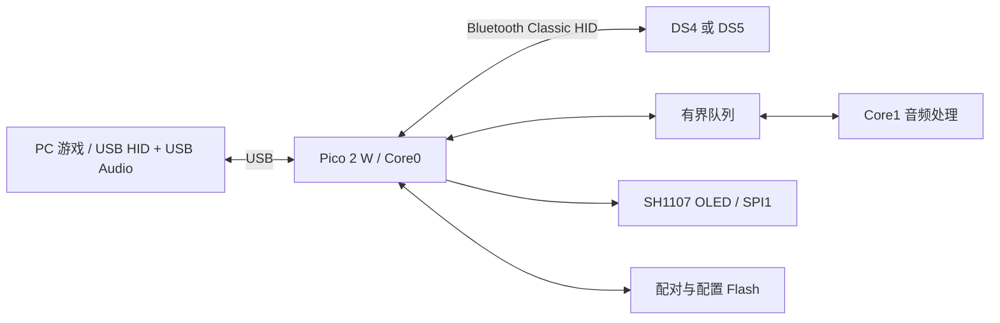

# 桥接、音频与配置实现

## 数据链路

输入、效果控制和音频不是同一条数据流。按键可以正常上报，但扬声器仍然静音；USB PCM 已到达也不等于蓝牙控制器接受了音频，更不等于手柄功放已打开。OLED 诊断的意义就在于把这些环节拆开观察。

本项目保留一个主循环、一套蓝牙栈和 USB 设备框架。DS4Dongle 是完整固件，不是链接一个库就能得到的功能；接入时复用其协议与描述符经验，在现有桥接生命周期中增加 DS4 后端，而不是同时运行两套 main / USB / Bluetooth 初始化。

## DS4 报告与音频控制

- USB 侧使用 DS4 对应的报告描述符和状态布局，蓝牙报告经校验后转换；初始化读取 0x05 校准和 0xA3 固件信息。
- DS4 的部分 Feature 报告与 DS5 的 CRC 规则不同。曾经连接数秒后断开、显示 Feature CRC E:A3，原因是沿用了不适用的报告校验规则。
- 播放路径为 USB **32 kHz / 16-bit / stereo PCM** → SBC → 蓝牙 **0x17 固定 462 字节报告**。编码在 Core1，控制和发送在 Core0，队列带代数防止停播／切换时旧数据回灌。
- 独立音量入口保留正确的音量更新允许位；目标 0x02 对应内置扬声器，0x24 对应耳机路径。初期沿用基础控制的 `flags & 7` 过滤会把音量许可清掉，结果是“看起来都在发送，手柄仍没声音”。
- Windows 音量与 OLED 本地数字增益分工，避免同一个音量重复衰减。DS4 麦克风流不在本项目目标内。

音频可以沿这条路径逐段检查：PC 有没有 PCM → 编码有没有产出 → 队列有没有丢 → L2CAP 有没有送出 → 路由／音量允许位对不对 → 实际听到没有。最后一步不能被计数器代替。

## DS5：双路声音需要设备身份，也需要状态保持

原生场景中，游戏可以把主音轨送给音箱，同时把专用音效送给 DualSense；音频四通道中前两路用于播放音频，后两路用于原生触觉。桥接端按 USB 数据和控制报告处理，不区分游戏名称。

排查中先对照了 SundayMoments/DS5_Bridge 与 awalol 上游的 USB 串号行为：DS5 的 iSerialNumber 恢复为 0，而 DS4 保留自己的既有行为。这是可以确认的兼容差异，但移除串号**单独没有解决当时的无声**。

后续本机观察到游戏同时存在于音箱和手柄端点的活动音频会话，手柄有非零音频数据。重新下发端点音量后，手柄音效恢复。后续修改因此集中在 HID 音量初始化和固件全状态回放。

修正包括：

1. 按允许位缓存游戏的音量、路由、静音与前置增益；无关灯条／扳机更新不覆盖它们。
2. 全状态重发保留当前有效音频控制，避免回放初始化前的默认值。
3. “锁定音量”启用及重连后恢复 USB 端点功放值；队列满时重试，成功后停止，避免持续强推。
4. Windows 端点的音量和静音仍然有效。

重新下发音量后的声音恢复已实机确认，自动恢复逻辑及整合版本的测试情况见 [验证记录](VALIDATION.md)。

## 四槽独立配置：保留原闪存布局

`Config_body` 的现有布局和各保存区地址不变，在 CONFIG 扇区第二个 256 字节页内放四份控制器配置。每条记录有独立 CRC，并绑定占用状态、蓝牙地址和配对代数。

只按 MAC 绑定不够：忘记某只手柄后，再配对同一个 MAC，不应该复活旧设置。配对代数用来区分这两个生命周期。清空／替换只重置相关槽；升级时复制旧共享设置到各槽，避免把用户刚保存的音量锁定弄丢。

配置草稿按槽隔离，单字段保存保留配置页，切槽会使 OLED 编辑缓存失效。保存仍依赖扇区擦写，使用双核 Flash 安全锁及回读验证；写入期间断电仍可能损失配置。记录校验和绑定不匹配时回退默认值，不冒用其他手柄设置。

振动新增真正的 0 倍率。除了游戏直接输出，还要检查固件发起的音量／灯条状态包是否重新携带未缩放的历史 rumble，这条旁路也已处理。

## 屏幕与实时性

SH1107 使用 SPI1、128×64 帧缓冲，中文字体是 Fusion Pixel 12px Proportional；prop16 指设置页 16px 行框，不是 16px 字体。屏幕旋转在帧缓冲转换层完成。

主界面信号条沿用 HCI Read RSSI 缓存：最多 10 Hz、一个请求在途。Classic RSSI 是相对接收功率理想范围的 dB，**不是 dBm**。0 表示处于理想范围，所以近距离一直满条合理；负值越低，填充越少；未知读数显示空框。

音频及蓝牙／USB 热路径有 RAM 驻留检查；Flash 擦写时 Core1 需要安全停驻，避免仍从 XIP 取指。使用上游已验证的 RP2350 150 MHz、XIP 分频 2、电压码 11 配置，并保留检查工具。

## 代码入口

| 文件 | 适合从这里看什么 |
| --- | --- |
| `src/bt.cpp`、`src/usb.cpp`、`src/main.cpp` | 连接生命周期、输入与输出报告 |
| `src/ds4_protocol.h`、`src/ds4_audio.cpp` | DS4 报告转换、路由、音量与 SBC |
| `src/audio.cpp`、`src/state_mgr.cpp` | DS5 音频和原生 HID 音频状态保持 |
| `src/controller_profile.h`、`src/config.cpp`、`src/slots.cpp` | 独立配置、CRC、配对绑定 |
| `src/home_zh.h`、`src/oled.cpp`、`src/settings_menu.h` | 主界面、SPI 显示、菜单 |
| `tests/host`、`tools/check_*` | 可在主机复现的逻辑测试和镜像检查 |

本版关闭厂商管理接口，配置通过 OLED 完成。DS5 Bridge 等桌面软件依赖各自的管理协议和配置布局，不能仅凭 Sony HID 身份识别并配置此固件。USB 的 Sony 兼容身份继续用于游戏识别，项目名称只用于启动画面和发布文件。
